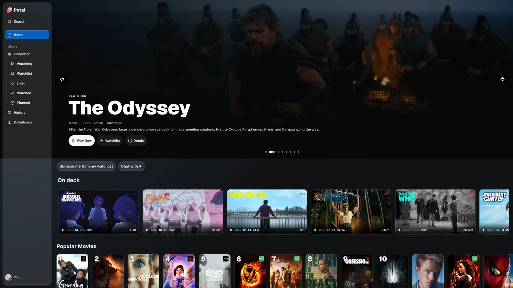
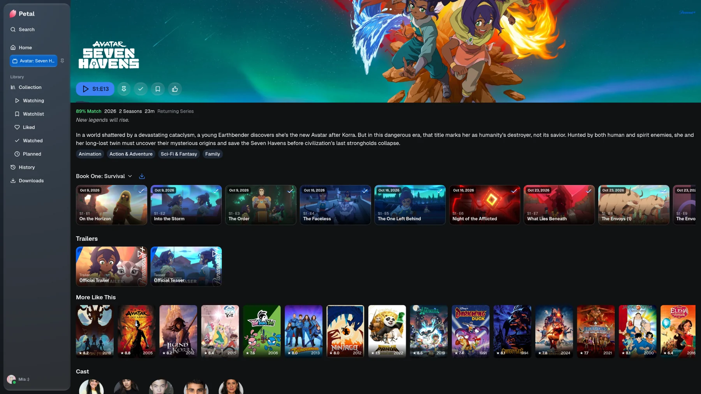
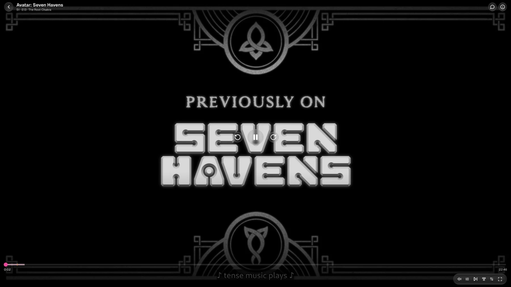
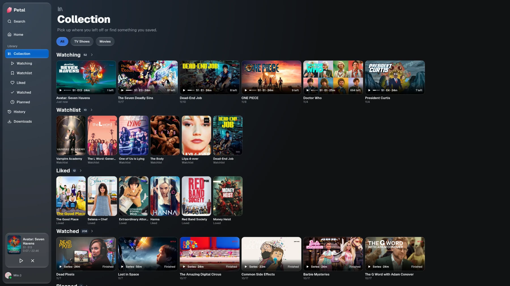
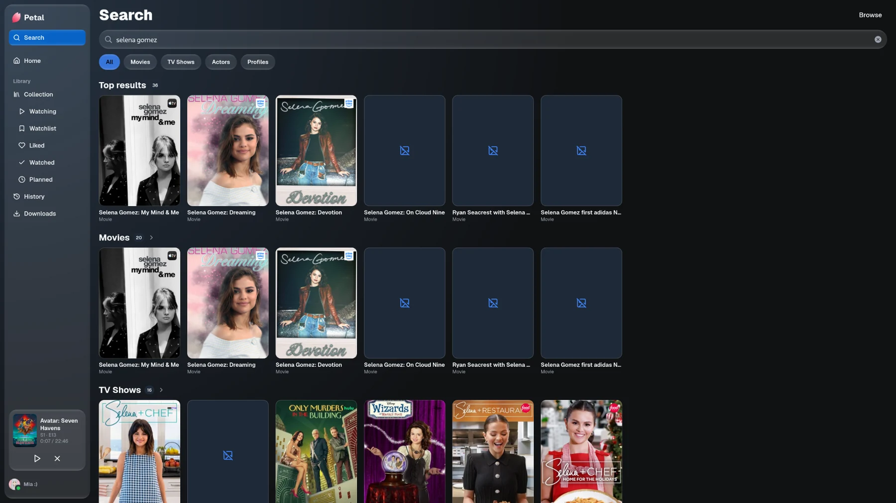
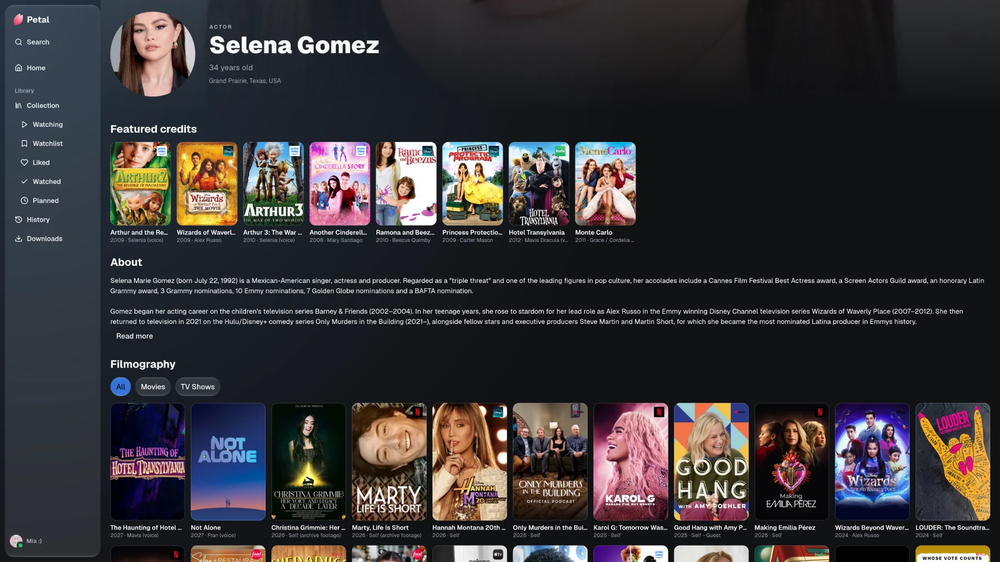
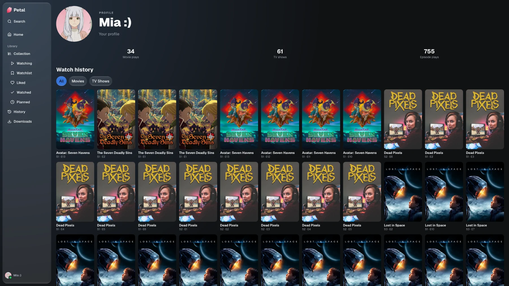
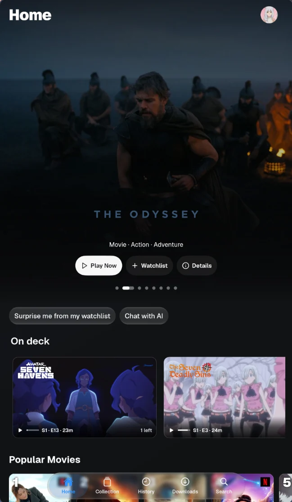
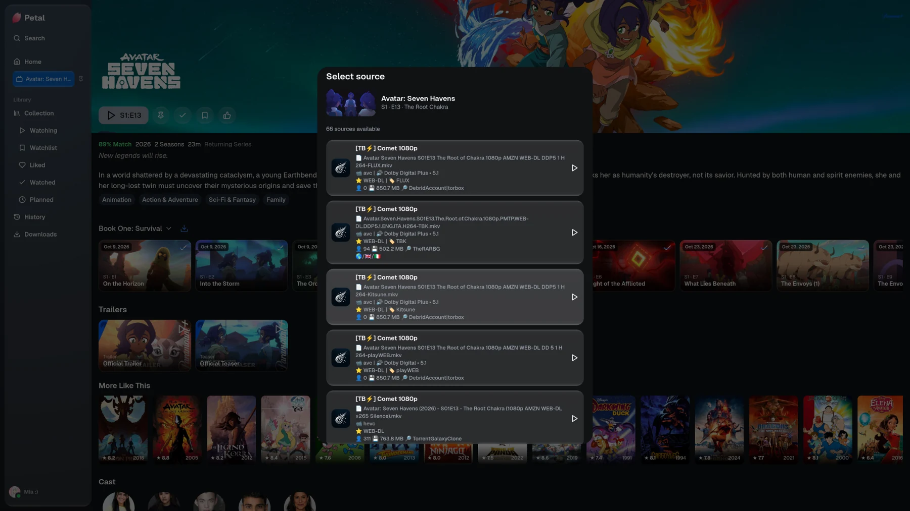

<div align="center">



# 🌸 Petal

**A cross-platform anime streaming client built with Flutter**

[](https://flutter.dev)
[](https://dart.dev)
[](LICENSE)
[](https://github.com/kawaiiepic/Petal/actions)
[](https://github.com/kawaiiepic/Petal/releases)

[**Discord**](https://discord.gg/D6a4p2G7Yn) · [**Join iOS TestFlight**](https://testflight.apple.com/join/fPpArZG7) · [**Download**](#-download) · [**Features**](#-features) · [**Screenshots**](#-screenshots) · [**Building**](#-building-from-source)

</div>

---

## ✨ Features

- 🎬 **Smooth video playback** via media_kit with hardware acceleration
- 🖼️ **Picture-in-picture** support on desktop and mobile
- 🔍 **Fuzzy search** — find titles even with typos
- 💾 **Session & cookie management** for seamless auth
- 🌐 **Cross-platform** — Linux, Windows, Android, and iOS from one codebase
- 🎨 **Clean UI** built with shadcn_flutter

---

## 📦 Download

Grab the latest desktop and Android builds from [**Releases**](https://github.com/kawaiiepic/Petal/releases).

[](https://testflight.apple.com/join/fPpArZG7)

Install Apple's [TestFlight app](https://apps.apple.com/app/testflight/id899247664), then open the invitation link to join the Petal beta. Availability depends on beta approval and tester capacity.

| Platform | Download |
|----------|----------|
| 🤖 Android | `app-release.apk` |
| 🍎 iOS | [Join the TestFlight beta](https://testflight.apple.com/join/fPpArZG7) |
| 🐧 Linux | `release-linux.zip` |
| 🪟 Windows | `release-windows.zip` |

> **Linux / Windows:** Extract the zip and run the executable from within the extracted folder — do not move the executable out on its own.

---

## 🖼️ Screenshots

### Desktop

<div align="center">



</div>

| Show overview | Video player |
|:---:|:---:|
|  |  |
| **Collection** | **Search** |
|  |  |
| **Actor overview** | **User profile** |
|  |  |

### Compact layout

<div align="center">



</div>

<details>
<summary>Source selection preview</summary>



</details>

---

## 🔨 Building from Source

### Prerequisites

- [Flutter](https://docs.flutter.dev/get-started/install) 3.27+
- For Linux: `ninja-build`, `libgtk-3-dev`, `libmpv-dev`

### Steps

```bash
git clone https://github.com/kawaiiepic/Petal.git
cd Petal
flutter pub get
```

```bash
# Android
flutter build apk

# iOS (no codesign)
flutter build ios --release --no-codesign

# Linux
flutter build linux

# Windows
flutter build windows
```

> **Linux users:** After building, run the app from inside `build/linux/x64/release/bundle/` or set `LD_LIBRARY_PATH` to point at its `lib/` folder.

---

See [Code structure](docs/code_structure.md) for the source layout and verification commands.

## 💬 Community

[](https://discord.gg/D6a4p2G7Yn)

Join the Petal Discord to share feedback, report bugs, get help, and discuss new features.

---

## 🤝 Contributing

PRs and issues are welcome! If something is broken or you want a feature, open an issue.

---

<div align="center">

Made with 🌸 and Flutter

</div>